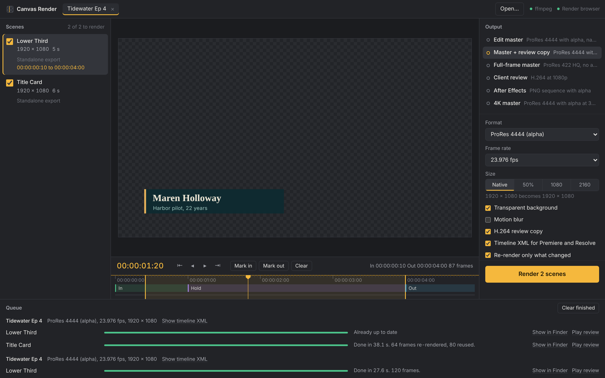
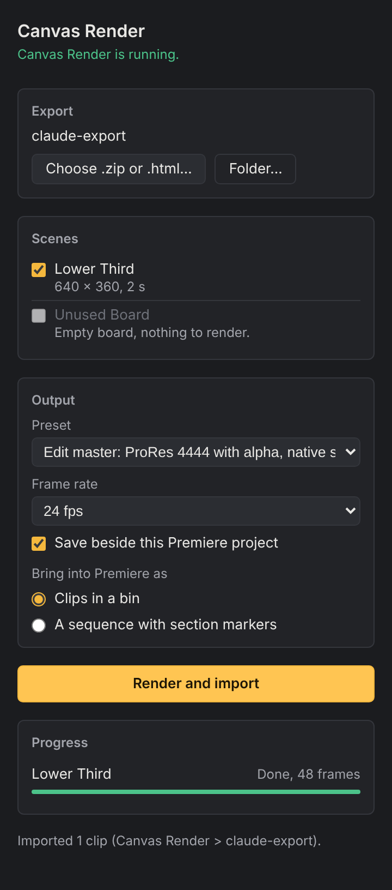

# Canvas Render

[](https://github.com/cris-pen/canvas-render/actions/workflows/ci.yml)

Render Claude Design exports and HTML animations to ProRes, H.264 and PNG sequences, from a Mac app or straight from a Premiere Pro panel.



Built for editors who get sent Claude Design projects to fix up or finish. Drop the export in, scrub it, mark in and out, and render the files an edit actually needs: an alpha master to cut over picture, a review copy to send, a timeline that lands in Premiere with the board's sections already marked. When the client sends a revised export, only the frames that changed are rendered again.

## What it does

- **Opens what you're sent.** A Claude Design project .zip, a standalone .html export, a folder, or any HTML animation: CSS keyframes, Web Animations, GSAP, `requestAnimationFrame` and canvas. Every board in a project shows up as a scene. Empty boards are skipped, and boards that fail to load show the error from the board itself.
- **Edit formats.** ProRes 4444 and 4444 XQ with alpha, ProRes 422 HQ, H.264 and PNG sequences with alpha. Exact NTSC rates (23.976 is 24000/1001), sizes up to 3840 × 2160, everything tagged Rec. 709.
- **Motion blur.** Set the shutter angle and samples. Samples are spread across the shutter and averaged in premultiplied space, so edges over transparency stay clean.
- **Re-renders only what changed.** A quick low-resolution pass compares every frame with the last render. Changed frames are rendered and spliced into the existing ProRes master, and the rest is reused. In the screenshot, renaming an episode title re-rendered 64 frames and reused 80.
- **Timeline XML.** One sequence with every rendered scene end to end and the board's named sections as markers. Imports into Premiere Pro and DaVinci Resolve.
- **A scrubber that works like an editor.** Frame-accurate timecode, the board's sections on the ruler, I and O for in and out, arrow keys to step frames, up and down to jump between sections.
- **Batches.** Render every board in an export in one go, with presets for the usual deliverables.

## Premiere Pro panel



The panel lets you stay in Premiere. Choose an export, tick the scenes, pick a preset and press **Render and import**. The renders land in a **Canvas Render** bin, either as clips or as a sequence with the section markers. Render the same export again and the clips already in the bin are updated in place rather than imported twice.

Premiere blocks plain `http://` requests from panels on macOS, so the panel doesn't talk to the app over the network. It drops a small request file into the app's folder (`~/Library/Application Support/Canvas Render/mailbox`) and reads progress back the same way. That's why it needs full file system access, and why the Canvas Render app has to be open while you use it. If it isn't, the panel offers to open it.

<br clear="right">

## Install

You need a Mac, [Homebrew](https://brew.sh) and ffmpeg:

```sh
brew install ffmpeg
```

Then build the app from source:

```sh
git clone https://github.com/cris-pen/canvas-render.git
cd canvas-render
npm install
npm run app          # run it
npm run dist         # or build a .dmg in dist/
```

On first launch the app checks for ffmpeg and a render browser. If Google Chrome is installed it uses that. Otherwise it offers to download Chromium once (about 150 MB). The app isn't signed, so if you copy a built .dmg to another Mac, right-click the app and choose **Open** the first time.

For the Premiere panel (Premiere Pro 25.6 or later):

```sh
npm run panel        # builds release/com.crispenstanbach.canvas-render_premierepro.ccx
```

Double-click the .ccx to install it through Creative Cloud, or load `panel/manifest.json` in UXP Developer Tool. It shows up under **Window > UXP Plugins > Canvas Render**.

## Command line

The engine also runs on its own, which is handy for scripts and for 4K masters on a render machine:

```sh
npx canvas-render info  export.zip                          # list scenes, sizes, lengths and sections
npx canvas-render render export.zip --format prores4444 --rate 23.976
npx canvas-render render export.zip --scene "Lower Third" --size uhd --blur 180:16 --review
npx canvas-render serve --open                              # the app's UI in your browser
```

Run `npx canvas-render --help` for every option. Renders go to `~/Movies/Canvas Render/<project>` unless you pass `--out-dir`.

Try it on the included example: `npx canvas-render render examples/tidewater-export --review`.

## How it works

Each scene loads in headless Chromium with a virtual clock, so time only moves when the renderer says so. Claude Design boards are moved to each frame through their exportable-video contract: the stage is sized from its attributes and seeked with its `data-om-seek-to-time-frame` event. Ordinary pages run on the virtual clock, which drives timers, `requestAnimationFrame` and CSS animations in lockstep. Frames are captured at output resolution and piped into ffmpeg. Fonts and libraries from public CDNs are cached on disk, so a project that rendered once renders offline.

## Status

- **Engine.** Tested in CI on Linux and macOS with real renders: ProRes 4444 with alpha, PNG sequences, motion blur, CSS and canvas pages, and a partial re-render checked frame by frame against a clean render. It has also rendered real Claude Design project exports correctly.
- **Mac app.** CI starts it on macOS, waits for the engine and the window, and builds the .dmg. It hasn't had much real-world use yet.
- **Premiere panel.** Tested against stand-ins for Premiere's API that talk to a real engine through the real mailbox: choosing an export, rendering, importing into bins, and re-rendering. It hasn't been run inside Premiere yet.

## Limits

- **Share links.** Claude artifact links need you to be signed in, so the app can't fetch them. Open the artifact, choose **Export > Download as .zip**, and drop the zip in.
- **Audio.** Boards can carry audio, but it isn't mixed into renders yet.
- **Change detection resolution.** Frames are compared at 480 pixels wide. A very small, faint change, like a one-pixel line shifting slightly in color, can be missed. Turn off **Re-render only what changed** (or pass `--full`) for a clean render.
- **Signing.** The app isn't signed or notarized yet. The CI build is for Apple silicon; on an Intel Mac, `npm run dist` builds an Intel copy.

## Development

```sh
npm test             # engine, server, panel and render tests (needs ffmpeg and Chrome)
npm run serve        # the UI in a browser, against a live engine
```

| Folder | What's in it |
| --- | --- |
| `engine/` | Ingest, the virtual clock, capture, encoding, change detection, XML, the HTTP server and the Premiere mailbox |
| `ui/` | The app window: plain HTML, CSS and JavaScript served by the engine |
| `app/` | The Electron shell for macOS |
| `panel/` | The Premiere Pro UXP panel |
| `fixtures/`, `examples/` | Clean-room boards for tests and demos |

Canvas Render isn't made by or affiliated with Anthropic. Claude is a trademark of Anthropic.

## License

MIT
